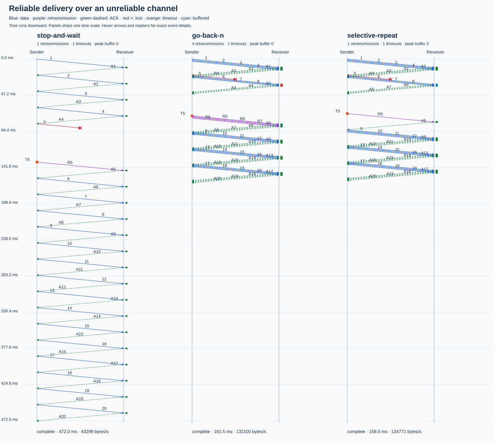

# Selective Repeat ARQ

A deterministic, dependency-free Go simulator comparing **Stop-and-Wait**, **Go-Back-N**, and **Selective Repeat** over an unreliable channel.

Transfer the same ordered payload under identical serialization delays, propagation delays, and packet-identity loss rules. Inspect protocol timelines, receiver buffering, retransmissions, and throughput.

## Quick start

Requires Go 1.22 or later. No services, containers, or third-party Go modules are needed.

```sh
go run ./cmd/arqsim compare --scenario scenarios/loss-five.json --out out/loss-five
go run ./cmd/arqsim run --protocol selective-repeat --scenario scenarios/ack-loss.json --out out/ack-loss
go run ./cmd/arqsim compare --window 8 --timeout-us 50000 --out out/window-eight
go run ./cmd/arqsim verify
go test ./...
```

Open `out/loss-five/comparison.svg` in a browser. Individual protocol SVGs use their own time scale for a closer view; the comparison uses a shared time scale.

## The packet-five demonstration

Send 20 packets of 1,000 bytes with window 4, 1 ms data serialization, 0.1 ms ACK serialization, 10 ms one-way propagation, and a 50 ms timeout. Drop only the first transmission of packet **5**.

| Protocol | Data transmissions | Retransmissions | Duplicate arrivals | Out-of-order discards | Peak buffer | Delivery time | Sender completion |
|---|---:|---:|---:|---:|---:|---:|---:|
| Stop-and-Wait | 21 | 1 | 0 | 0 | 0 | 461.9 ms | 472.0 ms |
| Go-Back-N | 24 | 4 | 3 | 3 | 0 | 151.4 ms | 161.5 ms |
| Selective Repeat | 21 | 1 | 0 | 0 | 3 | 148.4 ms | 158.5 ms |

All three reconstruct the same 20,000 payload bytes. Each records one timeout.

Go-Back-N discards packets 6–8 while waiting for packet 5, then retransmits 5–8. Selective Repeat buffers and acknowledges 6–8, retransmits only 5, then releases the contiguous buffered data. Stop-and-Wait also retransmits only 5, but pays a round-trip wait for every packet.



The time advantage of Selective Repeat is modest in this particular configuration: it saves three transmissions, while both windowed protocols wait for a timeout. The simulator lets you explore how serialization time, delay, window size, timeout, and loss affect that trade-off.

## Protocol contracts

| Protocol | Sender window | ACK meaning | Receiver | Timeout recovery |
|---|---|---|---|---|
| Stop-and-Wait | Always 1 | Last accepted packet | Deliver expected packet; re-ACK duplicates | Retransmit outstanding packet |
| Go-Back-N | Configured window | Highest contiguous accepted packet | Discard out-of-order arrivals | Retransmit outstanding window |
| Selective Repeat | Configured window | Individual accepted packet | Buffer within receive window | Retransmit timed-out packet only |

IDs start at 1 and increase monotonically. ACK 0 means no contiguous data has been accepted. Sequence-number wraparound is deliberately excluded.

Go-Back-N has one effective timer for the oldest unacknowledged packet. Advancing the base restarts that timer if its new oldest packet has already begun transmission. Selective Repeat has a timer for each outstanding packet. Its sender base advances only through a contiguous prefix of acknowledged packets; an isolated ACK does not open a new slot beyond the window.

All protocols re-acknowledge already accepted packets. Duplicate ACKs never trigger fast retransmit. Timeout generation numbers invalidate stale timer events.

## Channel and scheduling model

- Simulation time is integer microseconds. No sleeps, goroutines, wall-clock scheduling, or random generator influence results.
- Independent full-duplex data and ACK links serialize transmissions. Arrival occurs after serialization plus one-way propagation delay.
- Lost transmissions still occupy the link for their serialization duration.
- Timers start when data transmission actually begins. Pending retransmissions are deduplicated and canceled if acknowledgment arrives before transmission starts.
- Events are ordered by time, then arrivals before data transmission starts before timeouts, then insertion order. An ACK arriving at its timeout deadline wins.
- No corruption, jitter, congestion control, finite channel queues, or network reordering is modeled. Fixed-delay links preserve transmission order; a lost packet creates a gap in the received ID sequence.
- Payloads are deterministic synthetic bytes. Each completed run compares the entire reconstructed payload with the original.

The ACK link reserves serialization slots when a receiver emits an ACK. Its trace record describes the reserved start time, so raw trace records need not be chronologically sorted. The verifier sorts a copy before replaying observable events. Arrivals beyond the run's end are not processed; SVG lines crossing the end are clipped.

## Scenarios

Scenario JSON overlays these defaults; unknown fields are rejected:

```json
{
  "packets": 20,
  "packet_bytes": 1000,
  "window": 4,
  "data_us": 1000,
  "ack_us": 100,
  "delay_us": 10000,
  "timeout_us": 50000,
  "max_us": 10000000,
  "max_events": 100000,
  "loss": [{"direction": "data", "packet_id": 5, "attempt": 1}]
}
```

`direction` is `data` or `ack`. `attempt` is counted independently for each direction and packet/ACK ID. An attempt of **0** drops every transmission matching that direction and ID. Overlapping rules are combined using OR.

Identity-based loss rules make the comparison reproducible. Protocols emit different ACK sequences, so the same ACK-ID rule does not necessarily drop the same number of ACKs across protocols.

Included scenarios: `no-loss`, `loss-five`, `ack-loss`, `burst-loss`, `repeated-loss`, and `permanent-loss`.

`--window` and `--timeout-us` override JSON settings. Stop-and-Wait always uses window 1. Invalid configuration exits with status 1. A transfer hitting its time/event limit writes its partial reports, then exits with status 1. `max_events` counts all popped events, including obsolete timers and deferred transmission starts.

Resource bounds: at most 10,000 packets, 1,000,000 bytes per packet, and 100,000,000 payload bytes total; maximum simulated time is 10^12 microseconds. Individual timing values cannot exceed the run's time limit. Large traces can still produce large reports; use conservative event limits for experiments with very short timeouts.

## Outputs and metric definitions

Each run writes `scenario.json` (resolved configuration), `summary.json`, `summary.csv`, `comparison.svg`, individual protocol SVGs, and JSON traces under `traces/`. Reusing an output directory overwrites the matching generated files.

| Metric | Meaning |
|---|---|
| Transmissions | Started data transmissions, including lost attempts |
| Retransmissions | Data attempts after the first attempt for that ID |
| Duplicate packets | Repeated arrivals of an ID, including IDs previously discarded |
| Out-of-order discards | Arrivals rejected because they cannot be accepted by the receiver |
| Delivered packets | Unique packets delivered to the application in order |
| Delivery time | Time when the receiver has the entire payload |
| Completion time | Time when the sender has confirmation for the entire transfer |
| Goodput | Original payload bytes / delivery time, in bytes per second |
| Peak buffer | Maximum out-of-order packets retained by the receiver |
| Average buffer | Time integral of retained packets / observed run duration |
| Timeout events | Effective timer expirations; obsolete timer events do not count |

Delivery time and goodput remain zero until the complete payload is delivered. Completion time remains zero until sender confirmation completes. `complete`, `reason`, and `end_us` distinguish an incomplete run from a completed transfer. A receiver can finish delivery while the sender remains incomplete because final ACKs are lost.

SVGs show data, ACKs, losses, retransmissions, timeout markers, and receiver events. Green receiver marks mean delivery, cyan means buffering, and red means discard. Hover titles provide packet IDs, attempts, exact times, and buffer occupancy. Packet labels are staggered for readability; large or highly retransmitted scenarios can require zooming and consulting JSON traces.

## Validation

```sh
go test ./...
go vet ./...
go run ./cmd/arqsim verify
go test ./internal/sim -run '^$' -fuzz FuzzProtocols -fuzztime 15s -parallel 2
go build ./cmd/arqsim
```

`verify` enumerates 960 combinations: three protocols, five window sizes, and all 64 first-attempt loss subsets for six packets, applying each subset to data and ACK IDs. It requires completion and invokes an independent trace verifier. Tests additionally cover repeated losses, permanent loss, cumulative ACK recovery, timeout-deadline ties, short timeouts, resource limits, deterministic replay, corrupt output, CLI errors, CSV structure, and SVG XML validity.

The independent verifier checks sender-window bounds, transmission/arrival timing and causality, ordered delivery, metric totals, and synthetic payload reconstruction. It does not call sender/receiver transition methods. Fuzzing varies packet count, window, timeout, loss direction, and lost packet identity; bounded incomplete runs are permitted and must still satisfy trace invariants.

The bundled demonstration SVG was rasterized and visually inspected. Browser interaction was not verified because the local browser automation helper failed to start.

No GitHub Actions or workflows are included. Validation runs locally.

## Source map

```text
cmd/arqsim/          CLI, comparison and bounded verification commands
internal/sim/       Event queue, channel, protocol state machines, trace verifier
internal/report/    CSV/JSON exports and SVG rendering
scenarios/          Reproducible loss patterns
docs/               Checked-in demonstration artifacts
```

The shared engine keeps channel behavior identical across protocols; explicit protocol branches contain their differing ACK, buffering, window, and timeout policies. Rendering consumes simulation results and cannot affect protocol state.
